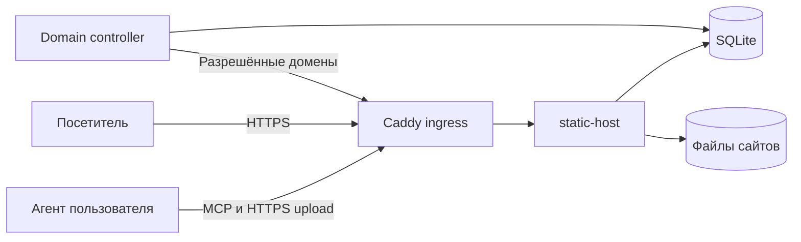

# Тематическая выдержка: infrastructure

Источник: неизменяемый снимок raw/2026-11-25-architecture.md. Выдержка создана при инициализации wiki; это не новое решение.

## Предлагаемая реализация

Начальный стек: Go, SQLite и файловая система. Это техническая рекомендация, а не результат реализации или нагрузочного тестирования.

Uncloud разворачивает общий `static-host`; публикация сайта не вызывает `uc deploy`. Caddy завершает TLS и направляет запросы к приложению. Один контейнер обслуживает MCP, загрузки и статические файлы на логически раздельных HTTP-поверхностях. Управляющие endpoints недоступны через пользовательские hostname.



Основной процесс не получает SSH-ключи, Docker socket или Uncloud API socket. Отдельная привилегированная роль domain-controller синхронизирует разрешённые домены с ingress. Конкретный механизм синхронизации с Uncloud/Caddy требуется выбрать и проверить перед реализацией. Нельзя вручную изменять генерируемый Uncloud Caddyfile или принимать пользовательский Caddyfile.

## Наблюдения о кластере

Снимок исследования 2026-11-25; не гарантия актуального состояния:

- Uncloud CLI и машины — 0.21.0; edge-1 и uc-1 доступны.
- edge-1 имеет публичный IP, 1 CPU, около 1 ГБ RAM и около 11 ГБ свободного диска.
- uc-1 не показывает публичный IP; его CPU/RAM/диск не исследованы.
- Единственный сервис Uncloud — healthy Caddy `caddy:2.11.7` на edge-1. Uncloud volumes отсутствуют.
- Настроенный домен Uncloud был `uc.tiangroup.su`; выбор `uc.afbmarket.ru` — проектное решение, не выполненное изменение DNS/кластера.
- Wildcard DNS, DNS-provider API и наличие нужного Caddy-модуля не проверены.

Начальное размещение static-host на edge-1 с постоянным каталогом — предложение. Это single-node хостинг без HA. Uncloud не выполняет автоматическое rescheduling; второй узел сам по себе не устраняет отказ единственного публичного ingress. Сборки на малом edge не выполняются.

## Открытые вопросы перед реализацией

- Вход пользователей, подключение агентов и поддерживаемые MCP-клиенты.
- DNS-провайдер и credentials для wildcard TLS; фактическая настройка нового домена.
- Безопасный механизм domain-controller для установленной версии Uncloud/Caddy.
- Политика DNS proxy, перепроверки активных доменов, IDNA-нормализации и TLS retries.
- Квоты, допустимые архивы, лимиты, хранение аудита и политика удаления сайтов.
- Backup target, требования к доступности и проверка ресурсов uc-1.

## Правила агентской разработки

# Инструкции для агентов static-host

## Проект

Многопользовательский статический хостинг с MCP для пользовательских агентов. Принимает готовые сайты; не собирает и не исполняет пользовательский код. Базовый домен: `uc.afbmarket.ru`.

Приложение пока не реализовано. Не считать предлагаемый стек, API или документацию доказательством работающего поведения.

## Документация и память

- Основной документ: [docs/architecture.md](docs/architecture.md). Все проектные документы вести в `docs/`.
- Локальная OKF LLM Wiki находится в `docs/wiki/`, не в стандартной `.llm-wiki`.
- Перед работой с проектными знаниями сначала читать `docs/wiki/index.md`, затем связанные секционные индексы и страницы. Если нужной темы нет, использовать OKF search с явным bundle.
- Следовать skill `llm-wiki-okf`, если доступен. Все команды OKF направлять явно в `docs/wiki/`; не создавать параллельную вики.
- `docs/wiki/raw/` — неизменяемые датированные снимки источников. При изменении решения добавлять новый источник, не переписывать старый.
- Factual Source/Note страницы имеют frontmatter `type`, `sources`, timestamp; внутренние ссылки root-relative относительно wiki bundle.
- Изменение смысла отражать в timeline и log. Индексы пересобирать; запускать `okf lint docs/wiki --strict-frontmatter` и устранять ошибки и предупреждения.
- Согласованные изменения сначала фиксировать в основной документации, затем обновлять источники и соответствующие wiki-страницы. Не допускать противоречий и не выдавать предположения за решения.
- OKF — память и навигация, не второй независимый архитектурный контракт.

## Инварианты

- Сайт принадлежит пользователю; агент получает отзываемые права на сайты владельца. Владелец определяется авторизацией, не входным owner_id.
- Полный upload атомарно заменяет сайт. Незавершённая загрузка не меняет текущую публикацию.
- Нет пользовательских версий и rollback. Generation и временные каталоги — технические механизмы.
- Пользовательская публикация не вызывает инфраструктурный deploy и не получает доступ к Docker/Uncloud/SSH.
- Свои домены подключаются без TXT: CNAME на конкретный сайт предпочтителен, IP — разрешённое упрощение с явно описанным риском захвата ещё не закреплённого домена.
- Hostname глобально уникален; не переносить домен между владельцами автоматически. Неизвестный Host не обслуживает какой-либо сайт.
- Разделять управляющие endpoints и недоверенный HTML. Поддомены afbmarket.ru не считать отдельной site-границей.

## Рабочий процесс

1. Прочитать wiki и релевантную документацию; исследовать актуальный код и инструменты. При конфликте задокументированного решения с запросом явно назвать изменение.
2. Делать минимальное законченное изменение; предпочитать простые конструкции, существующие паттерны и явные контракты.
3. Проверять права, квоты, ошибки, конкурентные публикации и последствия для текущего сайта в затронутых путях.
4. Запускать узкую проверку изменённого поведения. Для bugfix добавлять regression test, если путь не покрыт. Не выдумывать команды сборки и тестов: брать из реально появившейся конфигурации.
5. Обновлять затронутую документацию и wiki вместе с поведением. В отчёте перечислять выполненные проверки и оставшиеся ограничения.

## Безопасность и инфраструктура

- Не хранить токены, SSH-ключи, cookies, приватные конфиги и содержимое пользовательских сайтов в документации, wiki или логах.
- Не выполнять изменения production, DNS, TLS, миграции с потерей данных и удаление пользовательских файлов без явного разрешения на соответствующее действие.
- Не редактировать генерируемый Uncloud Caddyfile вручную.
- Отделять результаты текущих проверок от исторических наблюдений. Не считать новый проектный домен уже настроенным.
- Не перезаписывать чужие изменения и не делать коммиты автоматически без соответствующего рабочего процесса/запроса. При использовании OKF отключать его автоматические git commits, если коммит не разрешён.

## Проверки документации

```sh
okf index docs/wiki
okf lint docs/wiki --strict-frontmatter
```

Команды приложения появятся после выбора и реализации стека. Сейчас доступна проверка документации, не runtime сервиса.
