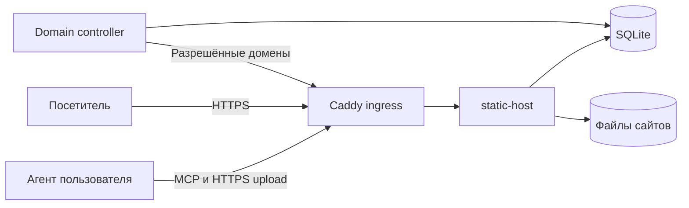

# Архитектура static-host

Статус: согласованное направление; реализован только локальный HTTP-сервер проверки состояния.
Дата решений: 2026-11-25.

## Назначение и границы

Многопользовательский сервис публикации готовых статических сайтов через MCP. Пользователи подключают собственных агентов; агент действует от имени владельца сайтов. Сервис принимает полный готовый снимок HTML/CSS/JS и файлов, публикует его и возвращает URL.

Генерация, исходники, сборка и восстановление старого содержимого остаются у пользователя и его агентов. Сервис не выполняет пользовательские команды, Dockerfile, npm install, SSR или серверный код. Контейнер на каждый сайт не создаётся.

## Принятые решения

- Базовый домен — `uc.afbmarket.ru`.
- Сайт принадлежит пользователю, а не агенту. Несколько агентов могут работать с одним сайтом в пределах выданных прав.
- Каждая публикация полностью заменяет содержимое сайта. Отсутствующие в новом снимке файлы удаляются из опубликованного набора.
- Пользовательских релизов, истории содержимого, preview-версий и rollback API нет.
- Замена содержимого атомарная: незавершённая загрузка не затрагивает работающий сайт.
- Поддерживаются собственные домены. Отдельная TXT-проверка владения не используется; проверяется DNS-направление.
- Предпочтительный способ подключения — CNAME на системный адрес конкретного сайта. Для корневых доменов допускается проверка A/AAAA по адресам ingress.
- Документация проекта хранится в `docs/`, агентская база знаний OKF — в стандартной `.llm-wiki/`; инструкции агентам — в корневом `AGENTS.md`.

## Предлагаемая реализация

Начальный стек: Go, SQLite и файловая система. Это техническая рекомендация, а не результат реализации или нагрузочного тестирования.

Текущая основа запускается с Go 1.27.4 или новее: `go run ./cmd/static-host`. Сервер слушает только `127.0.0.1:8080`; `GET /healthz` возвращает `ok` и перевод строки, `HEAD /healthz` — те же заголовки без тела. Остановка — SIGINT или SIGTERM. Проверка сборки: `go test ./...`. Порт 8080 должен быть свободен.

Хостинг сайтов, SQLite, MCP, авторизация и развёртывание пока не реализованы; описание ниже относится к будущей системе.

Uncloud разворачивает общий `static-host`; публикация сайта не вызывает `uc deploy`. Caddy завершает TLS и направляет запросы к приложению. Один контейнер обслуживает MCP, загрузки и статические файлы на логически раздельных HTTP-поверхностях. Управляющие endpoints недоступны через пользовательские hostname.

Основной процесс не получает SSH-ключи, Docker socket или Uncloud API socket. Отдельная привилегированная роль domain-controller синхронизирует разрешённые домены с ingress. Конкретный механизм синхронизации с Uncloud/Caddy требуется выбрать и проверить перед реализацией. Нельзя вручную изменять генерируемый Uncloud Caddyfile или принимать пользовательский Caddyfile.

## Владельцы и авторизация

Сущности:

- `users`: владельцы сайтов;
- `agents`: отдельные отзываемые credentials пользователя и ограничения доступа;
- `sites`: владелец, системный ID, текущий каталог, generation и настройки;
- `uploads`: временные загрузки с ограничениями и состоянием;
- `domains`: глобально уникальный hostname, сайт, DNS- и TLS-статус;
- `audit_events`: действия пользователей и агентов без секретов и истории содержимого.

Агенту можно выдать доступ ко всем либо выбранным сайтам владельца и отдельные разрешения на чтение, публикацию и домены. `owner_id` определяется сервером по авторизации; входной site_id не является доказательством доступа. Все операции, включая upload и domains, проверяют владельца и scope.

Предлагается remote MCP через Streamable HTTP. Способ входа пользователя, выдача credentials и совместимость со стандартной MCP HTTP authorization должны быть определены перед реализацией. Для статических agent-токенов хранить только проверочное представление, поддерживать отзыв и срок действия.

## Публикация без истории версий

1. Авторизованный агент создаёт upload для конкретного сайта.
2. Получает короткоживущий HTTPS URL, лимиты и инструкции загрузки.
3. Загружает архив полного сайта вне MCP-контекста модели.
4. Сервис проверяет архив и распаковывает его во временный каталог.
5. Подготовленный каталог переносится в постоянную область на той же файловой системе.
6. Одна транзакция переключает текущий каталог сайта и увеличивает `generation`.
7. Старый каталог удаляется после завершения использующих его запросов. Незавершённые загрузки и неиспользуемые каталоги очищаются после сбоя.

Временное сосуществование двух каталогов — механизм безопасной замены, не пользовательская версия и не возможность rollback. Ошибка до переключения оставляет прежний сайт доступным.

`expected_generation` предотвращает молчаливую потерю конкурентных изменений. `idempotency_key` позволяет безопасно повторить запрос после таймаута. Generation — счётчик публикаций, не хранилище версий.

Атомарность действует на отдельный HTTP-запрос, не на все запросы страницы браузера. Рекомендуются content-hashed имена assets. Старые assets после замены не гарантируются. Политика кэширования не должна выдавать изменяемый HTML как immutable.

Удалённый MCP не может прочитать локальный путь агента. Агенту нужен HTTP upload либо локальный адаптер; base64-архивы через MCP не являются основным способом передачи.

Предлагаемые инструменты: `sites_create`, `sites_list`, `sites_get`, `uploads_create`, `sites_publish`, `domains_add`, `domains_check`, `domains_list`, `domains_remove`, `domains_set_primary`. Длительная операция возвращает статус/ID операции, а не преждевременный успех. Точные схемы ещё не определены.

## Адреса и домены

| Адрес | Назначение |
| --- | --- |
| `panel.uc.afbmarket.ru` | Кабинет пользователя |
| `mcp.uc.afbmarket.ru` | MCP endpoint |
| `upload.uc.afbmarket.ru` | Upload API |
| `<site-id>.sites.uc.afbmarket.ru` | Системный адрес сайта и цель CNAME |

Системные site-id генерируются сервером и не переиспользуются. Это не секреты и не замена авторизации. Сайт может иметь несколько доменов и один основной; дополнительные домены обслуживают тот же сайт либо перенаправляют на основной по явной настройке.

### CNAME — основной путь

Пример: `www.example.com CNAME s-7k3m9.sites.uc.afbmarket.ru`.

Сервис проверяет CNAME-привязку к системному адресу именно выбранного сайта, глобальную уникальность hostname и направление трафика на ingress, затем настраивает маршрут и сертификат. Общий CNAME на ingress без указания сайта не даёт такой же привязки к владельцу.

### A/AAAA — альтернативный путь

Для корня домена допускается A на публичный IPv4 ingress, AAAA — только при реально работающем IPv6. ALIAS/ANAME и flattening обычно видны сервису как итоговые IP и проверяются по модели IP, не CNAME. DNS не должен направлять часть запросов на посторонние адреса.

Принятый риск: совпадение IP подтверждает направление трафика, но не право конкретного пользователя управлять доменом. Другой пользователь может первым заявить ещё не прикреплённый домен, уже указывающий на общий edge. Это осознанное упрощение вместо TXT-проверки; его нельзя описывать как доказательство владения.

Ограничения: один hostname на один сайт во всём сервисе; никакого автоматического переноса между владельцами; конфликт разрешается текущим владельцем или администратором. Пользовательские wildcard-домены не входят в начальный объём. Удалённый/неизвестный hostname не обслуживает прежний или случайный сайт.

DNS с проксированием, например Cloudflare proxy, может скрывать origin CNAME/IP. Политика поддержки такого режима пока не определена; нельзя объявлять успешной проверку, которая не видит нужную привязку.

### DNS и TLS lifecycle

`pending_dns → provisioning_tls → active`; ошибки выпуска видны отдельно и допускают повтор после исправления. Удаление привязки отключает маршрут. Active означает проверенную доступность по HTTPS, а не только запись в БД.

Системным hostname нужен wildcard DNS и сертификат `*.sites.uc.afbmarket.ru`; wildcard TLS требует DNS challenge и совместимого Caddy DNS-модуля. Для своих доменов предлагается явный список разрешённых hostname и автоматический выпуск сертификатов, без неограниченного on-demand TLS. Изменение файлов сайта не меняет ingress-конфигурацию.

## Безопасность и эксплуатация

- Пользовательский HTML — недоверенный активный контент. Никогда не обслуживать его на управляющих hostname.
- `uc.afbmarket.ru` и его поддомены остаются в общей site-границе `afbmarket.ru`; дополнительный поддомен не даёт изоляцию отдельного регистрируемого домена.
- Кабинет использует host-only `__Host-` session cookie без Domain, CSRF-защиту и строгую проверку Origin. Не использовать общие cookies на `.afbmarket.ru` или `.uc.afbmarket.ru`. Проверить существующие приложения с domain cookies перед публичным запуском.
- Upload URL ограничен владельцем, сайтом, временем и объёмом. Запрет traversal, symlink/hardlink и специальных файлов; лимиты распакованного размера, количества файлов и параллельных загрузок.
- Квоты хранения и трафика, rate limits, аудит и очистка временных файлов обязательны для многопользовательского режима. Конкретные значения определяются отдельно.
- Нет directory listing, исполнения серверного кода, произвольных команд, пользовательской конфигурации ingress и серверного fetch произвольных URL.
- Разрешённые redirects, headers и SPA fallback задаются ограниченной схемой, не произвольным серверным конфигом.
- Резервное копирование согласованной SQLite БД и файлов — за пределы edge; проверять восстановление. Backup не является пользовательским rollback.

## Наблюдения о кластере

Снимок исследования 2026-11-25; не гарантия актуального состояния:

- Uncloud CLI и машины — 0.21.0; edge-1 и uc-1 доступны.
- edge-1 имеет публичный IP, 1 CPU, около 1 ГБ RAM и около 11 ГБ свободного диска.
- uc-1 не показывает публичный IP; его CPU/RAM/диск не исследованы.
- Единственный сервис Uncloud — healthy Caddy `caddy:2.11.7` на edge-1. Uncloud volumes отсутствуют.
- Настроенный домен Uncloud был `uc.tiangroup.su`; выбор `uc.afbmarket.ru` — проектное решение, не выполненное изменение DNS/кластера.
- Wildcard DNS, DNS-provider API и наличие нужного Caddy-модуля не проверены.

Начальное размещение static-host на edge-1 с постоянным каталогом — предложение. Это single-node хостинг без HA. Uncloud не выполняет автоматическое rescheduling; второй узел сам по себе не устраняет отказ единственного публичного ingress. Сборки на малом edge не выполняются.

## Открытые вопросы перед реализацией

- Вход пользователей, подключение агентов и поддерживаемые MCP-клиенты.
- DNS-провайдер и credentials для wildcard TLS; фактическая настройка нового домена.
- Безопасный механизм domain-controller для установленной версии Uncloud/Caddy.
- Политика DNS proxy, перепроверки активных доменов, IDNA-нормализации и TLS retries.
- Квоты, допустимые архивы, лимиты, хранение аудита и политика удаления сайтов.
- Backup target, требования к доступности и проверка ресурсов uc-1.

## Справочные источники

- https://uncloud.run/docs/
- https://uncloud.run/docs/concepts/ingress/publishing-services/
- https://uncloud.run/docs/concepts/ingress/managing-caddy/
- https://uncloud.run/docs/release-notes/v0.21.0/
- https://modelcontextprotocol.io/specification/latest/basic/transports

Решения продукта основаны на обсуждении с владельцем проекта; технические предложения и непроверенные предположения помечены отдельно.
